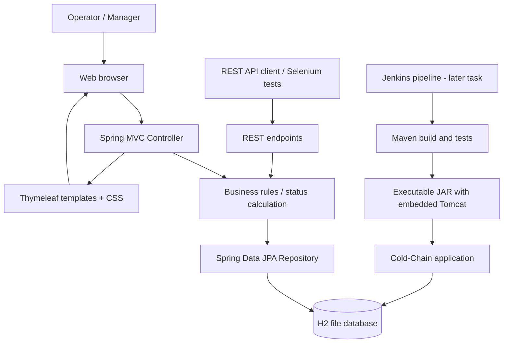

# Task 3 — Application architecture

## Design notes
- **Presentation:** Thymeleaf templates and CSS.
- **Controller:** Handles page requests and REST endpoints.
- **Business logic:** Derives status by comparing a reading with its configured minimum and maximum.
- **Persistence:** Spring Data JPA writes to an H2 file database.
- **Deployment:** Maven packages an executable JAR with embedded Tomcat. Jenkins, Docker, and Ansible will be introduced in later tasks.
